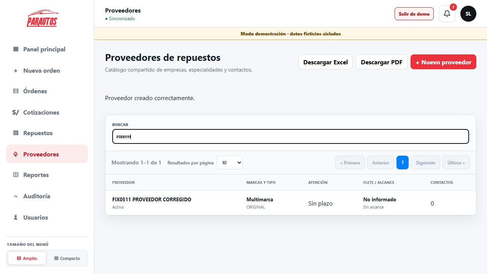

# Correcciones de la revisión funcional

Fecha: 05/11/2026. Aplicadas al checkout local, sin despliegue en Hostinger, nuevas dependencias ni migraciones de esquema.

| Hallazgo | Cambio aplicado | Verificación |
|---|---|---|
| H1. Devoluciones del técnico | El saldo del taller suma las devoluciones y resta entregas y devoluciones al proveedor. El cálculo utiliza milésimas para evitar errores de coma flotante. | API: recibir → entregar A → devolver A → entregar B funciona; una entrega adicional se rechaza. Pruebas unitarias de devolución parcial, devolución al proveedor y cantidades decimales. |
| H2. Responsable de instalación | Los movimientos recuperan el técnico y el servidor valida su saldo individual. La devolución también exige responsable. Se conserva el bloqueo transaccional de la línea para serializar movimientos. | API: B no puede instalar ni devolver unidades de A; B sí instala una unidad entregada a B; se rechaza instalar dos veces y devolver sin técnico. |
| H3. Proveedor guardado con falso error | Se conserva la referencia del formulario antes de esperar la API; se bloquea el envío mientras está pendiente y se muestra un mensaje distinto si falla la actualización de la lista después del guardado. | Alta real en navegador: mensaje de éxito, formulario cerrado, búsqueda con un solo resultado `FIX0511 PROVEEDOR CORREGIDO`. |
| H4. Identidad placa/VIN | Se buscan y bloquean las identidades existentes dentro de la transacción. Un VIN de otra placa o un VIN distinto para una placa registrada produce HTTP 409 con mensaje claro. Se elimina el upsert ambiguo; las colisiones concurrentes de clave única también se convierten en conflicto. Si no se proporciona VIN para una placa existente, se conserva el VIN registrado. | API: VIN ya registrado con otra placa devuelve 409; nueva identidad conserva la placa; nueva recepción de esa identidad mantiene intacta la instantánea previa. Pruebas de servicio para conflicto de ambas identidades y colisión concurrente. |
| H5. Aviso demo sobre botones | El aviso pasa al flujo normal, debajo del encabezado y antes del contenido; deja de ser una capa fija sobre las acciones. Se actualizan CSS y LESS. | Navegador de escritorio: clic desde checklist, consideraciones y daños hasta evidencias. Vista móvil de 375×812: clic desde evidencias hasta resumen. Se restauró el tamaño del navegador al terminar. |

## Resultados

- `npm test`: **188 pruebas aprobadas**, 3 omitidas (servidor 145, cliente 43). Las omitidas corresponden a integración de migraciones y no se presentan como aprobadas.
- `npm run build:app`: compilación TypeScript y build de producción satisfactorios. No se ejecutó `npm run build`, que incluye migraciones de despliegue.
- `git diff --check`: sin errores de espacios.
- API local real: **24 comprobaciones satisfactorias y 0 fallidas**. [Evidencia de regresión](regresiones-api.json).
- H3 y H5 se comprobaron con interacción real de navegador; no se añadieron dependencias de pruebas DOM. La captura de abajo muestra el alta y el nuevo lugar del aviso demo.

## Datos y límites

Las nuevas escrituras de verificación se realizaron exclusivamente en el modo demo: línea de repuesto #5 de la solicitud #2, órdenes #4015 y #4016 y proveedor `FIX0511 PROVEEDOR CORREGIDO`. Se conservaron para trazabilidad.

Los cambios impiden repetir los cinco defectos en los escenarios comprobados. No reparan automáticamente los registros históricos creados durante la reproducción anterior (por ejemplo, la orden #4014 con conflicto de placa y el movimiento de instalación asignado al técnico incorrecto). Alterarlos requiere una decisión explícita sobre su corrección; no se borró ni reescribió evidencia.

No se ejecutó una prueba de carga o concurrencia real contra MariaDB: el caso de colisión concurrente se cubre en la prueba del servicio y los movimientos siguen protegidos por la transacción y el bloqueo de la línea. Continúan vigentes los límites de la auditoría original respecto de cámara, exportaciones no revisadas y producción.
