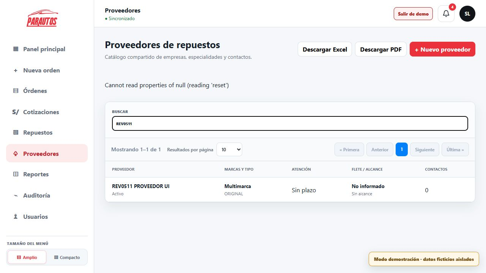

# Revisión funcional local de PARAUTOS

> **Actualización posterior:** los cinco hallazgos de esta revisión fueron corregidos y verificados localmente el 05/11/2026. Este documento conserva la evidencia original; consulte [Correcciones y validación](CORRECCIONES.md) para el estado actual.

Fecha de cierre de esta revisión: 5 de noviembre de 2026. Pruebas de API y suite automatizada ejecutadas el 2 de noviembre; continuación de interfaz realizada el 5 de noviembre.

## Resultado

El flujo principal permite registrar una recepción, cotizar, generar solicitudes de repuestos, recibirlos, iniciar la reparación, verificar el trabajo y entregar el vehículo. Sin embargo, no corresponde declarar que todas las altas están libres de problemas: se identificaron **cinco hallazgos reproducidos**, incluidos errores de inventario y de identificación del vehículo.

Revisión del checkout local en `a5caf97` (`feat: incorpora cotizaciones y repuestos independientes`). No se modificó código de la aplicación ni se desplegaron cambios. Las escrituras de prueba se realizaron en el modo demostración; no se eliminaron registros. El servidor local estaba detenido al retomar la revisión y se inició mediante `npm run dev`.

## Evidencia y alcance

| Tipo de comprobación | Resultado | Fecha / precisión |
|---|---|---|
| Integración mediante la API real, a través de localhost:5173 | 90 comprobaciones: 88 satisfactorias y 2 fallidas | 02/11; [detalle JSON](../2026-11-02/revision-api.json). No se repitieron todas el 05/11. |
| Suite automatizada del servidor | 138 pruebas aprobadas, 3 omitidas | 02/11; las omitidas requieren configuración de base temporal para migraciones. |
| Suite automatizada del cliente | 43 pruebas aprobadas | 02/11. |
| Navegador, acceso y navegación de módulos | Correctos en las vistas recorridas | 05/11; sesión, demo, recepción, órdenes, cotizaciones, repuestos, proveedores, reportes, auditoría y usuarios. |
| Alta de proveedor por interfaz | Registro creado; mensaje de error posterior | 05/11; hallazgo H3. |
| Alta de recepción por interfaz | Orden creada con firma sintética y checklist | 05/11; se detectó discrepancia de placa, H4. |
| Cotización independiente por interfaz | Crear, marcar enviada, aprobar y descargar PDF | 05/11; total S/150.00, una partida de mano de obra. |

Los resultados automatizados corresponden a 181 pruebas aprobadas y 3 omitidas, no a cobertura total del código. Su salida está en `tmp/revision-local-2026-11-02-tests.txt`. Los conteos de API no incluyen las comprobaciones manuales adicionales del navegador.

## Flujo de trabajo comprobado

| Módulo | Comprobación realizada | Resultado y límite |
|---|---|---|
| Acceso | Inicio de sesión válido; API sin sesión; cierre e invalidación | Acceso correcto; solicitudes sin sesión rechazadas. No se crearon cuentas ni se cambiaron permisos. |
| Panel | Indicadores, prioridades y recordatorio de pendientes | Carga y navegación correctas. El recordatorio se puede cerrar para continuar. |
| Recepción | API rechaza datos incompletos y ausencia de firma; navegador recorre los seis pasos, registra observaciones y firma sintética | Se crea la orden. Se encontraron H4 y H5. |
| Conservación histórica | Segunda recepción del mismo cliente/vehículo y corrección operativa con motivo | La instantánea de la primera recepción conserva los valores originales comprobados. |
| Evidencias | Carga y descarga de PNG de prueba mediante API, comparación de bytes y acceso sin sesión | Persistencia correcta; acceso no autorizado rechazado. No se probó cámara física. |
| Cotización de orden | Guardar borrador, generar versión, enviar y aprobar | Correcto. Aprobar sin enviar previamente se rechaza. |
| Cotización independiente | Alta por navegador, una partida S/150, envío y aprobación | Correcto. Omite filas sin descripción e informa cuántas omitió. PDF descargado: `D:/Descargas/Cotizacion_COT-2026-823397.pdf`, 911568 bytes. No se evaluó visualmente todo el PDF ni la exportación Excel. |
| Solicitudes | Alta independiente, líneas, proveedor y técnico; solicitud desde cotización aprobada | Correcto en el recorrido API. Duplicar la generación desde la misma cotización se rechaza. |
| Repuestos | Recepción parcial y completa, entrega a técnico e instalación | Validaciones básicas funcionan, pero H1 y H2 invalidan escenarios importantes de inventario. Historial de ambos casos visible en la interfaz. |
| Reparación | Intento antes de contar con repuestos y después de recibirlos completamente | Bloqueo previo correcto; avance posterior permitido. Caso sin repuestos también comprobado. |
| Control final y entrega | Verificación de mano de obra, completar, publicar y entregar | Bloquea completar sin verificar y entregar sin publicar; rechaza falta de conformidad. La orden termina entregada. |
| Proveedores | Alta API y alta navegador, búsqueda posterior | El alta API funciona; la interfaz falla después de guardar, H3. |
| Reportes | API e interfaz de resumen | Métricas y gráficas cargan. No se certificó la conciliación contable de todos sus indicadores. |
| Auditoría | Consulta API e interfaz | Se observan creación de proveedor #140, orden 4014 y eventos del flujo previo. |
| Usuarios | Consulta del directorio y formulario | Carga correcta. No se ejecutaron altas, bajas ni cambios de credenciales o rol. |
| Aislamiento demo | Salida de demo y búsqueda de prefijo de pruebas en el ámbito principal | La búsqueda API no devuelve las órdenes sintéticas del demo. |

El flujo actual requiere generar explícitamente la solicitud de repuestos después de aprobar la cotización. La expectativa inicial de que se crearan automáticamente registros históricos `order_parts` fue corregida en el guion de pruebas; no se contabiliza como defecto de la aplicación.

## Hallazgos reproducidos y correcciones recomendadas

### H1. Una devolución del técnico no repone el saldo disponible del taller — prioridad alta

**Pasos:** solicitud #2, línea #3: recibir una unidad, entregarla al técnico A, registrar su devolución y volver a entregarla. Los tres primeros movimientos se guardan; el último devuelve HTTP 400 `WORKSHOP_QUANTITY_EXCEEDED` pese a que la unidad regresó al taller.

**Causa:** `server/src/modules/parts/routes.ts:70` calcula el saldo de taller restando entregas y devoluciones al proveedor, pero no suma las devoluciones del técnico.

**Mejora:** calcular los saldos a partir de todos los movimientos que aumentan o reducen cada ubicación, manteniendo transacción y bloqueo. Evitar fórmulas independientes que puedan divergir entre interfaz y servidor.

**Regresión necesaria:** recibir 1 → entregar 1 → devolver 1 → entregar 1 debe funcionar; entregar otra unidad debe rechazarse. Comprobar devolución parcial y devolución al proveedor.

### H2. Un técnico puede instalar una unidad entregada a otro — prioridad alta

**Pasos:** solicitud #2, línea #4: recibir una unidad, entregarla únicamente al técnico A y registrar instalación a nombre del técnico B. El servidor acepta HTTP 201; debía rechazar la operación por falta de saldo del técnico B.

**Causa:** el mismo endpoint agrega cantidades por línea sin consultar ni filtrar el responsable de cada movimiento. Exigir un identificador de técnico no garantiza que ese técnico tenga la pieza.

**Mejora:** validar el saldo por línea y técnico. Una transferencia entre técnicos debe quedar explícita y auditada, si el negocio la admite.

**Regresión necesaria:** B no instala ni devuelve stock de A; A sí puede instalarlo. Probar dos técnicos con cantidades diferentes y operaciones concurrentes.

### H3. Guardar proveedor muestra error aunque el registro ya existe — prioridad media

**Pasos:** crear `REV0511 PROVEEDOR UI` en el navegador. Aparece `Cannot read properties of null (reading 'reset')`; el formulario permanece abierto. Cerrar el formulario y buscar el nombre devuelve el proveedor registrado. La auditoría confirma `parts_provider #140`.

**Causa:** `client/src/providers-view.tsx:14` utiliza `event.currentTarget.reset()` después de `await`; para entonces `currentTarget` es nulo. La creación ya fue confirmada por el servidor y se interpreta como fallida por una excepción del reinicio visual.

**Mejora:** guardar la referencia del formulario antes del `await`, reiniciar mediante esa referencia y separar el resultado del guardado de errores de actualización visual. Deshabilitar el envío mientras esté pendiente.

**Regresión necesaria:** un envío crea un único registro, muestra éxito, cierra o limpia el formulario y actualiza la lista. Un error real de API conserva los datos introducidos y muestra un mensaje comprensible.

### H4. Un VIN repetido cambia silenciosamente la placa de la nueva orden — prioridad alta

**Pasos:** partir del borrador demo con VIN `8AJHA8CD0R1234567`, asociado a `ABC123`; cambiar cliente y placa a `QAU511`. En el resumen previo se muestra `QAU-511`. Al confirmar se crea `OS-2026-04014`, pero su lista y detalle muestran `ABC123`.

**Causa comprobada en código/esquema:** `database/migrations/002_cases_and_reception.sql:36-37` define unicidad tanto para placa como para VIN. El `INSERT ... ON DUPLICATE KEY UPDATE` en `server/src/modules/orders/orders-service.ts:142` reutiliza el vehículo ante cualquiera de esas colisiones y no actualiza la placa. Así, una colisión del VIN reutiliza la identidad anterior sin advertir que contradice la placa recibida.

**Mejora:** resolver explícitamente placa y VIN antes de crear la relación. Si identifican vehículos incompatibles, devolver un conflicto claro y pedir corrección. Si se admite cambio de placa, debe ser una operación explícita con trazabilidad; no una consecuencia silenciosa del alta. Conservar la instantánea histórica.

**Regresión necesaria:** mismo VIN/otra placa debe bloquearse o seguir un cambio explícito autorizado; misma placa/mismo VIN debe reutilizar el vehículo; placa y VIN pertenecientes a registros distintos deben rechazarse sin cambios parciales.

### H5. El aviso demo cubre botones del asistente — prioridad media

**Pasos:** ventana de escritorio de aproximadamente 1280×720; avanzar por checklist y daños. El aviso fijo de la esquina inferior derecha ocupa el área de «Continuar». En daños el clic no cambia de paso; enfocar el botón y pulsar Enter sí permite avanzar.

**Causa visual:** `.demo-mode-banner` en `client/src/styles.css:581` tiene posición fija, margen inferior de 18px y `z-index: 40`, sin reservar espacio respecto de la barra de acciones. La coincidencia depende de altura y desplazamiento.

**Mejora:** reservar una zona propia para el aviso o situarlo fuera de la barra de acciones. No basta con que el botón sea accesible mediante teclado: debe seguir siendo visible y accionable con ratón y tacto.

**Regresión necesaria:** escritorio de poca altura y móvil, con desplazamiento, botones anterior/continuar/crear y aviso demo presente. Verificar clic y teclado.

## Registros de prueba conservados

| Fecha | Registro | Finalidad |
|---|---|---|
| 02/11 | Prefijo `REV0211-265811`; órdenes 4012 y 4013 | Flujo con repuestos, entrega y servicio sin repuestos. |
| 02/11 | Solicitudes 2 y 3; líneas 1 a 4; técnicos 1 y 2; proveedor 139 | Inventario, devoluciones y responsabilidad. |
| 05/11 | Proveedor 140 `REV0511 PROVEEDOR UI` | Reproducción del error posterior al alta. |
| 05/11 | Orden 4014 `OS-2026-04014`, cliente `Rev0511 Cliente Ui` | Recorrido del asistente y conflicto de placa/VIN. |
| 05/11 | Cotización `COT-2026-823397`, placa `QUI511` | Alta independiente, envío, aprobación y PDF. |

Todos pertenecen al modo demo. No se hizo limpieza automática para conservar la evidencia. Las credenciales de acceso no se incluyen en este informe.

## Límites y siguiente validación

Esta revisión combina integración de API, pruebas automatizadas y recorridos reales de interfaz; no es una certificación de todas las combinaciones posibles. Quedan sin comprobar cámara física, todos los dibujos de daños, exportación Excel, contenido visual completo de los PDF, cambios de cuentas/roles, recuperación ante caída de red, concurrencia y carga. El seguimiento público de casos demo devuelve 404 porque su ruta se resuelve fuera del contexto demo; falta validar un caso principal autorizado con su código, sin publicar datos personales.

La validación automatizada de migraciones quedó parcialmente omitida. Tampoco se ejecutaron migraciones de despliegue, cambios en Hostinger ni pruebas contra producción.

Se recomienda corregir primero H4, H1 y H2; después H3 y H5. Cada corrección debe incluir las regresiones descritas y repetir el recorrido recepción → cotización → solicitud → recepción de repuestos → reparación → control final → entrega. Los fallos de negocio encontrados aun con la suite aprobada muestran que hacen falta esas pruebas específicas.
