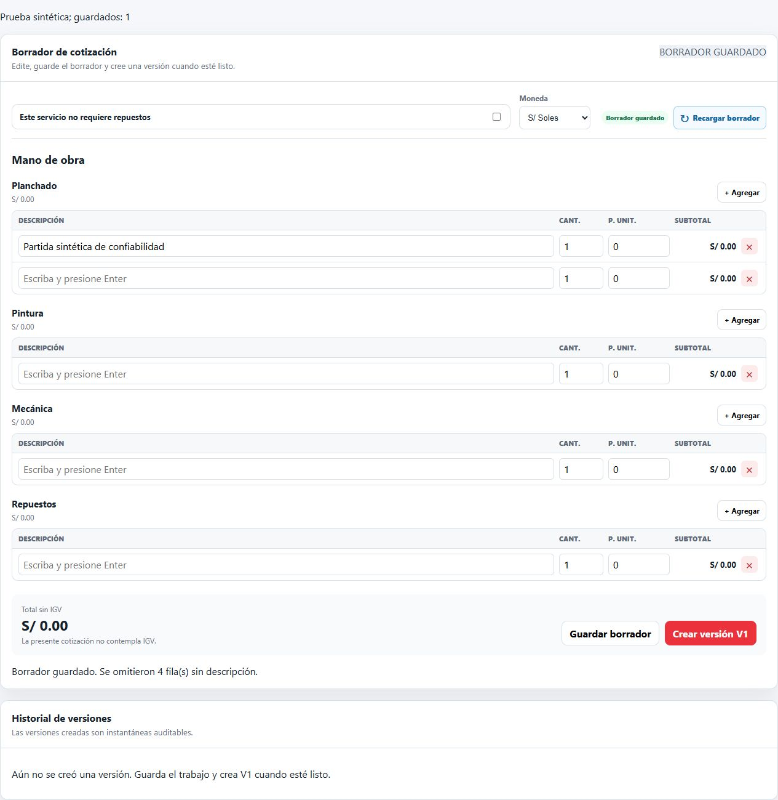

# Correcciones de confiabilidad — 25/10/2026

Se corrigieron los contextos de los nueve avisos LOW del análisis ampliado. Se conservaron los perfiles, reglas y exclusiones del análisis; no se marcaron avisos como aceptados ni falsos positivos.

## Cambios aplicados

| Regla | Avisos originales | Corrección |
|---|---|---|
| S6772 | 6 | Espacios explícitos en etiquetas de siniestro pendiente, legibilidad, revisión y confirmaciones. Se conservaron los controles, sus etiquetas y sus manejadores. |
| S6847 | 1 | Se retiró el bloqueo de Enter del formulario de cotización. El bloqueo de guardado implícito se limita a los campos de motivo, cantidad y precio; Enter en descripción sigue agregando partidas. Los botones recuperan su activación de teclado nativa. |
| S7503 | 1 | El inicio del servidor espera el evento listening con `node:events.once`. Los errores asíncronos de escucha llegan al manejador existente startup_failed; solo se anuncia inicio después de escuchar. |
| S7781 | 1 | La normalización de separadores usa replaceAll con cadena literal. Se conserva la validación contra rutas absolutas y segmentos de traversal. El reemplazo global anterior ya era funcional; esta corrección simplifica la expresión. |

También se separó el texto de estado del borrador de un ternario anidado preexistente en el mismo componente de cotización. Sonar lo había registrado como nuevo al cambiar de ubicación el bloque. Se conserva el texto mostrado para borradores limpios, modificados y sin guardar.

No se cambiaron CSS, permisos, datos de negocio, esquemas ni dependencias. No se desplegó en Hostinger. El manejo agregado cubre errores de inicio, no constituye una implementación general de recuperación de errores después de iniciar el servidor.

## Verificación

- **151 pruebas aprobadas en 55 archivos**, incluidas las de integración con MariaDB y bases temporales; sin pruebas omitidas en la ejecución registrada.
- Tres pruebas nuevas comprueban que el servidor espera listening, registra un error simulado EADDRINUSE y maneja configuración inválida. Son pruebas con un emisor simulado; no se afirma haber ocupado un puerto real.
- Una prueba nueva comprueba múltiples separadores Windows y mantiene el rechazo de traversal después de normalizarlos.
- **build:app aprobado**, con la advertencia de tamaño del bundle ExcelJS ya existente.
- En navegador, con API simulada y datos sintéticos: Enter en descripción aumenta las filas de 4 a 5 sin guardar; Enter en cantidad no guarda; Enter sobre Guardar borrador produce exactamente un guardado y muestra Borrador guardado. La página temporal se retiró después de la verificación; no se enviaron escrituras al servidor de negocio.
- Cobertura V8: líneas **31,46 %**, sentencias **24,09 %**, ramas **19,20 %** y funciones **17,22 %**. La cobertura sigue siendo parcial.

La primera repetición del scanner falló al retirar una página temporal mientras estaba siendo leída. Esa ejecución no se usa para evaluar las correcciones; se repitió con el árbol estable.

## Evidencias

Los resultados posteriores están separados de la línea base en [despues-confiabilidad](despues-confiabilidad/). Incluyen perfiles, reglas, métricas, hallazgos históricos y abiertos, confiabilidad, Quality Gate, scanner y cobertura. [Pruebas](despues-confiabilidad/pruebas.log), [build](despues-confiabilidad/build.log) y [archivos modificados respecto de la línea base](despues-confiabilidad/archivos-modificados.json). La nueva prueba `server/src/server.test.ts` se añadió además de los archivos existentes enumerados.

## Resultado final de SonarQube

Los **9 avisos originales de confiabilidad quedaron FIXED automáticamente**. Confiabilidad: **0 avisos, calificación A**; quedan **472 avisos de mantenibilidad**. No hay nuevas claves de avisos abiertos respecto de la línea base. También se cerró el ternario preexistente del componente modificado, por lo que la reducción total es de diez avisos.

El procesamiento terminó correctamente y el **Quality Gate está OK**. Sonar informa cobertura combinada **24.2 %** y de líneas **29.3 %**. Las condiciones de cobertura/duplicación de código nuevo aparecen ignoradas por la política de cambios pequeños (`ignoredConditions`); no significa cumplimiento de una meta global de 80 %. No se cambiaron las reglas ni el gate.

El token temporal fue revocado. [Validación de cierre](despues-confiabilidad/validacion-cierre.json) y [pendientes actuales](despues-confiabilidad/hallazgos-pendientes.csv).
