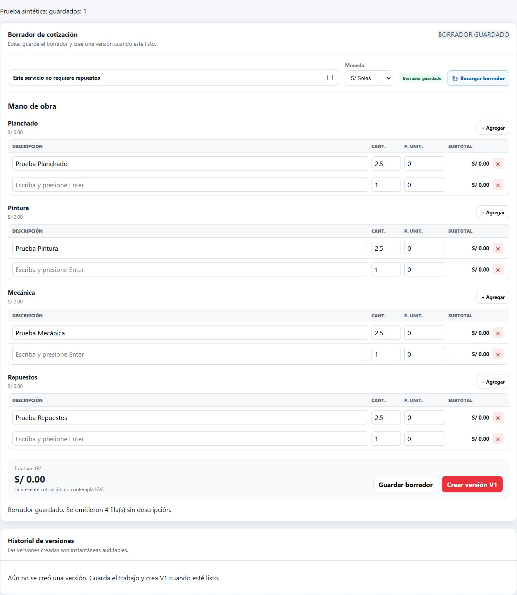

# Agregar partida con Enter desde cantidad

Enter en la cantidad agrega una partida de la misma categoría y enfoca su descripción, igual que desde descripción. Se mantiene el valor de la cantidad de la partida anterior. Precio y motivo conservan el bloqueo de guardado implícito; los botones mantienen su activación nativa de teclado.

Ambos campos comparten un manejador que previene el envío del formulario. La repetición al mantener Enter presionado no agrega filas adicionales. Durante la composición de texto IME no se intercepta Enter. No se cambiaron las reglas de validación de cantidades ni el guardado de partidas incompletas.

## Pruebas

- **155 pruebas aprobadas en 56 archivos**, incluidas cuatro nuevas sobre Enter, repetición de tecla, edición/navegación y composición IME.
- **build:app aprobado**; se conserva la advertencia de tamaño de ExcelJS.
- En navegador, con API simulada, se verificaron Planchado, Pintura, Mecánica y Repuestos. En cada categoría se ingresó cantidad **2,5**, Enter agregó exactamente una fila, conservó la cantidad, enfocó la descripción de la fila nueva y no guardó.
- Enter desde precio tampoco guardó. Enter sobre Guardar borrador produjo un único guardado explícito simulado.
- La página temporal se retiró antes de ejecutar SonarQube. No se modificaron datos reales ni se desplegó en Hostinger.

[Evidencia del navegador](enter-cantidad/navegador.json), [pruebas](enter-cantidad/pruebas.log) y [compilación](enter-cantidad/build.log).

## Resultado de SonarQube

**472 avisos de mantenibilidad pendientes y 0 de confiabilidad**. No se incorporaron avisos abiertos nuevos respecto del cierre anterior. Quality Gate **ERROR exclusivamente por cobertura de código nuevo: 42 % frente al 80 % requerido**. Ahora las condiciones ya no se ignoran. Código nuevo sin avisos y duplicación 0 % cumplen sus condiciones. El análisis se procesó correctamente; el código 3 del ejecutor corresponde al gate fallido. No se cambiaron reglas, perfiles ni umbrales. Las pruebas de navegador con API simulada no se incluyen en LCOV y no elevan esa cifra. Alcanzar el umbral requiere ampliar la cobertura automatizada de los componentes modificados, más allá de las pruebas unitarias del manejador. La fiabilidad funcional verificada no sustituye ese pendiente de cobertura.

[Validación](enter-cantidad/validacion.json), [pendientes](enter-cantidad/hallazgos-pendientes.csv) y [métricas](enter-cantidad/metricas.json).
